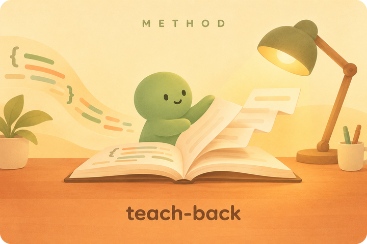
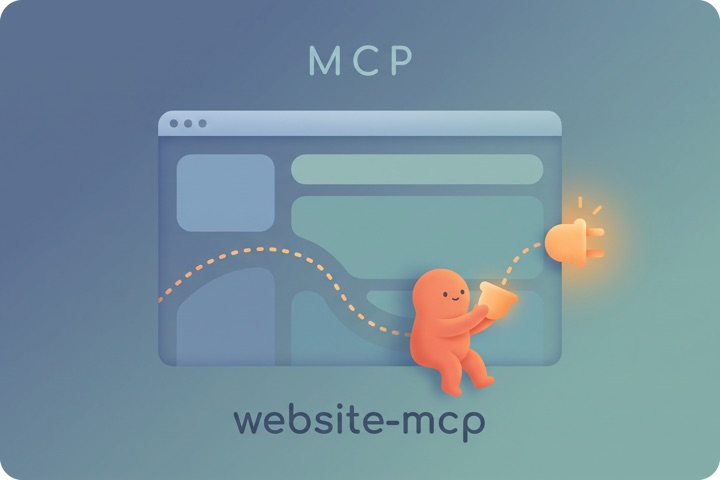
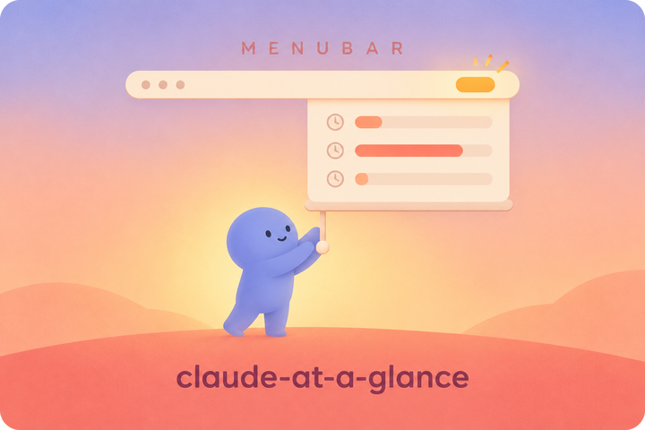

<h1 align="center">Adinath Chaudhari</h1>

  <strong>Product and AI</strong> 
  <em>Engineering at IIT Roorkee, management at INSEAD. I write the spec, then I build the tool.</em>

I take products from definition and system architecture to shipped software. These repositories are the hands-on side of that: tools I specified, built with AI agents and use myself. They range from a native Mac menu bar app in Swift to a Fire TV app in Kotlin, a Chrome extension with an MCP server, Claude Code plugins and Python pipelines.

Most began as a problem of my own, however niche. When a project already fits my use case, I improve it upstream. When a good open-source engine exists, I build the workflow around it.

## How I work

- **Spec first.** A written spec comes before any code. AI agents build from it, and I accept each stage against the spec and the tests. [The process, with real traces](https://github.com/AdinathChaudhari/google-drive-suite/blob/main/BUILD-WITH-AI.md).
- **Measured, or marked unmeasured.** Each README states what was measured and names the numbers that do not exist yet.
- **Local and reversible.** Tools run on your own machine, and the ones that change a device ship an undo.

## Latest projects

Three tools for building with AI agents, and for understanding what they built, newest first.

  
  
  

- **[teach-back](https://github.com/AdinathChaudhari/teach-back)** turns a codebase you built with AI into a four-level course you can answer from memory: pitch, whiteboard, "why not X?" and interview. 
  *Why:* code an AI helped build is only yours if you can explain and defend it with no AI beside you. 
  *Impact:* every claim in a course cites a line of the real code, and a separate agent checks it. The first course, on preflight-review, holds about 690 checked citations, and it keeps a clear line between what I decided and what the AI built.
- **[website-mcp](https://github.com/AdinathChaudhari/website-mcp)** turns a website task into a saved, tested tool that runs with no model. 
  *Why:* an agent that re-reads the same site pays for a model on every run. 
  *Impact:* published on [npm](https://www.npmjs.com/package/website-mcp). The [demo tool](https://github.com/AdinathChaudhari/website-mcp#demo) passes 8 of 8 test cases with no model call.
- **[preflight-review](https://github.com/AdinathChaudhari/preflight-review)** reviews a branch with AI before the push and reports only what it confirmed in the code. 
  *Why:* AI reviewers report guesses. 
  *Impact:* in the [seeded eval](https://github.com/AdinathChaudhari/preflight-review/blob/main/docs/measurements.md#eval-1--seeded-set-real-models-2026-10-30) on v1.0 it found 7 of 7 planted bugs, with 0 findings on the clean control. Recall on large real diffs is not measured yet.

## Passion projects

Built for my own use first.

  
  
  

- **[audiobook-maker-pro](https://github.com/AdinathChaudhari/audiobook-maker-pro)** turns a folder of audio, a YouTube video or a playlist into one chapterized audiobook, tuned for an iPod. 
  *Why:* I listen to long recordings on an iPod. Generic converters miss the details an old player depends on, and each of those details cost me a broken book. 
  *Impact:* books over 20 hours are [split at chapter boundaries](https://github.com/AdinathChaudhari/audiobook-maker-pro#faq) with no re-encode, because older iPods stop resuming very long books.
- **[google-drive-suite](https://github.com/AdinathChaudhari/google-drive-suite)** is four self-hosted tools for Google Shared Drives: bulk download, parallel upload, streaming to a Fire TV app and automatic offload. 
  *Why:* large Shared Drive libraries are slow to move and awkward to watch through the browser.
- **[claude-at-a-glance](https://github.com/AdinathChaudhari/claude-at-a-glance)** shows Claude Code's session and weekly usage limits, with reset times, in the Mac menu bar. A native Swift app. 
  *Why:* I kept typing `/usage` to see how much was left. 
  *Impact:* it reads Claude Code's own login on each check and never stores the token. 48 tests pass with no network.

Also built for myself:

- **[markdown-studio](https://github.com/AdinathChaudhari/markdown-studio)** reads, edits and typesets Markdown offline, as a 1 MB Mac app or a single HTML file, with 289 tests.
- **[i-cant-draw](https://github.com/AdinathChaudhari/i-cant-draw)** turns a rough image idea into a ready-to-paste prompt for ChatGPT or Gemini. The illustrations on this page were made with it.
- **[ipod-movie-maker](https://github.com/AdinathChaudhari/ipod-movie-maker)** prepares video for an iPod touch and checks each file against the device's decoder limits.
- **[housewatch](https://github.com/AdinathChaudhari/housewatch)** counts whole-house data usage from a router. A stretch it cannot prove is recorded as `unknown`, never estimated.
- **[orchard-tv](https://github.com/AdinathChaudhari/orchard-tv)** is an Apple TV-style home screen for a Fire TV Stick, with a reset back to the stock launcher.

## Open source

**Improving what I use.** When a project fits my use case, I read it properly and then propose an improvement.

- **[i-have-adhd](https://github.com/ayghri/i-have-adhd)**, a skill that makes a coding agent lead with the answer. I proposed two rules drawn from W3C cognitive accessibility guidance ([pull request](https://github.com/ayghri/i-have-adhd/pull/21)). It later inspired i-cant-draw.
- **[antivibe](https://github.com/mohi-devhub/antivibe)**, a skill that explains code so the reader learns it. I proposed a map mode for large codebases ([pull request](https://github.com/mohi-devhub/antivibe/pull/11)).
- **[torlink](https://github.com/baairon/torlink)**, a terminal torrent client. I proposed an opt-in setting that routes its searches through Tor ([pull request](https://github.com/baairon/torlink/pull/107)).

**Building on good engines.** I do not rewrite a good engine. I build the workflow around it.

- **[anydl](https://github.com/AdinathChaudhari/anydl)** on yt-dlp, streamlink and aria2c. One prompt takes any link and routes it to the right engine.
- **[streamlist](https://github.com/AdinathChaudhari/streamlist)** on yt-dlp and FFmpeg. Playlists become tagged M4A files, and re-runs fetch only what is missing.
- **[apple-to-ytmusic](https://github.com/AdinathChaudhari/apple-to-ytmusic)** on ytmusicapi. It mirrors Apple Music playlists to YouTube Music and never deletes anything.
- **[video-loop-extractor](https://github.com/AdinathChaudhari/video-loop-extractor)** on yt-dlp and FFmpeg. It finds a video's repeating loop and extracts one seamless clip.
- **[file-translator](https://github.com/AdinathChaudhari/file-translator)** on deep-translator. It renames a folder across languages from one edited sample, with an undo.

---

<a href="https://github.com/AdinathChaudhari?tab=repositories">All repositories</a>. Most READMEs include a transcript of a real run.

